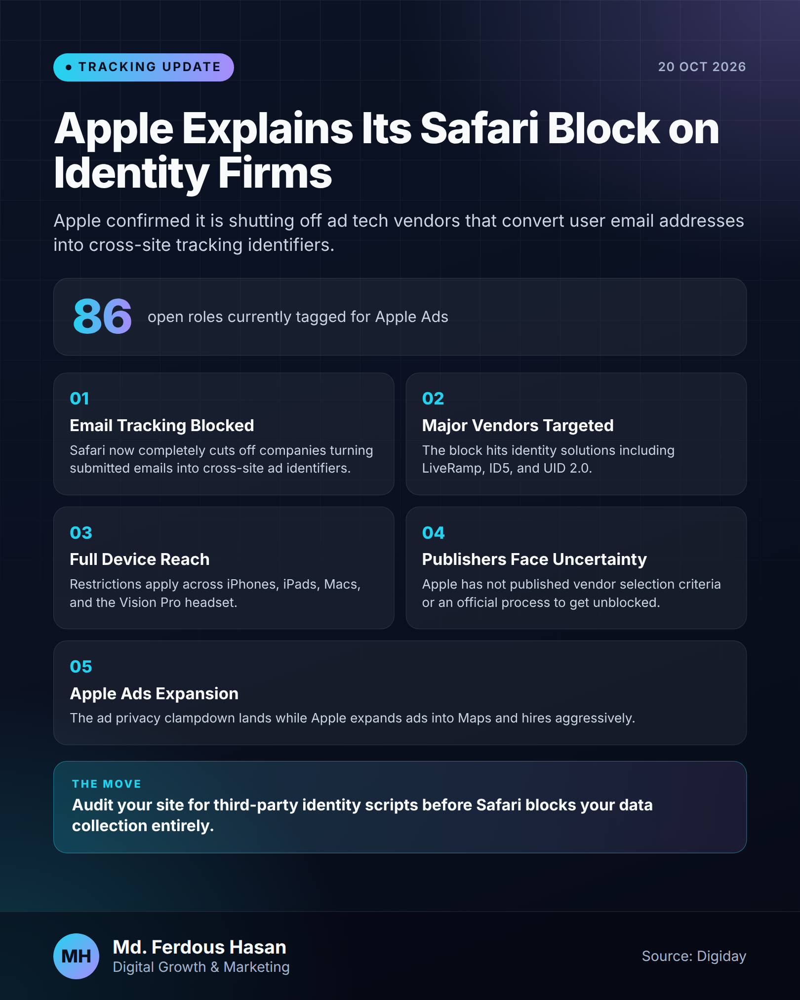
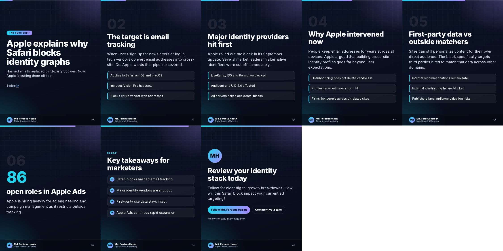

# LinkedIn Daily Agent

A self-hosted agent that runs a personal LinkedIn profile's daily content. Every day it reads marketing, business-growth and real-estate news, picks what matters, and posts **two posts**:

| Time (Asia/Dhaka) | Post | Content |
|---|---|---|
| **10:00** | Infographic (PNG) + short bullet caption | The single most important update of the day across all niches |
| **16:30** | PDF carousel (8–9 slides) + short caption | The top niche story of the last 24 h, written from its most engaging angle (never the morning story) |

It costs nothing to run. It uses only free LLM tiers (Gemini → Groq → OpenRouter), free RSS/Google News sources and LinkedIn's free "Share on LinkedIn" API, and it can be controlled from Telegram.

It also ships with a **Claude skill** (`skill/linkedin-agent-builder/`), so Claude can rebuild, migrate or fix this agent for you.

<p align="center">
  
  
</p>

A full sample carousel is in [`docs/samples/carousel.pdf`](docs/samples/carousel.pdf).

---

## Features

- **News collection:** about 20 direct RSS feeds plus Google News queries across three niches:
  - Tracking & analytics: GA4, GTM, server-side tagging, Meta CAPI, privacy, ad platforms
  - Business growth
  - Real-estate marketing
- **AI ranking:** a free LLM scores fresh stories by real impact, official platform changes, new data and actionability.
- **Grounded writing:** the full article is extracted and the model must use only its facts and numbers. No invented statistics.
- **Designed visuals:** HTML/CSS templates rendered with headless Chromium. Text auto-fits so it never overflows.
- **No repeats:** history is kept in SQLite. The afternoon post never reuses the morning story; matching is by URL, fuzzy title and keyword overlap.
- **Robust posting:**
  - Reserved characters are escaped and hashtags formatted the way LinkedIn's "little" text format requires.
  - `LinkedIn-Version` is auto-detected.
  - Failed posts are retried.
- **Telegram:**
  - Alerts after every post and on any failure, plus a token-expiry reminder.
  - Commands: `/preview`, `/post_morning`, `/post_afternoon`, `/status`.
- **Model-proof:** `MODEL=auto` discovers the newest free model, so renamed or retired models do not break it.
- **Safe ops:** runs as an unprivileged `liagent` user with `.env` at `chmod 600`, and includes optional server hardening.

## How it works

```
systemd timer (09:45 / 16:15)
  └─ agent.main <slot>
       ├─ news.collect()        RSS + Google News → dedupe → filters
       ├─ writer.rank()         LLM picks the top 5
       ├─ article extraction    full text keeps posts factual
       ├─ writer.*()            LLM → strict JSON content
       ├─ render.*()            HTML → PNG / multi-page PDF
       ├─ wait until 10:00 / 16:30
       ├─ linkedin.post_*()     upload media → create post
       └─ db.record() + Telegram notification
linkedin-telegram.service (always on) → remote commands
```

## Repository layout

```
.
├── agent/                 Python package
│   ├── config.py          settings from .env
│   ├── sources.py         niches, RSS feeds, Google News queries
│   ├── news.py            collection, dedupe, filters, article text
│   ├── llm.py             free-LLM client with fallback and auto model
│   ├── writer.py          ranking + content prompts, caption builder
│   ├── render.py          infographic and carousel templates
│   ├── linkedin.py        OAuth, uploads, posting
│   ├── telegram_bot.py    Telegram command bot
│   ├── db.py              SQLite post history
│   └── main.py            CLI entry point
├── scripts/
│   ├── install.sh         one-shot installer (Ubuntu/Debian)
│   ├── setkeys.sh         hidden-input key setup + LinkedIn connect
│   ├── harden.sh          firewall, fail2ban, auto security updates
│   └── wipe_old_agent.sh  remove a previous agent (asks first)
├── systemd/               timers and services
├── skill/linkedin-agent-builder/
│   ├── SKILL.md           Claude skill: full build/deploy/operate procedure
│   └── references/troubleshooting.md
├── docs/samples/          example outputs
├── .env.example
├── requirements.txt
└── run.sh                 wrapper: ./run.sh <command>
```

## Requirements

- Ubuntu 22.04/24.04 or Debian 12 VPS (1 vCPU / 1 GB RAM is enough), with root access
- Free accounts on:
  - [Google AI Studio](https://aistudio.google.com/apikey): Gemini key
  - [Groq](https://console.groq.com/keys): backup LLM key
  - [LinkedIn Developers](https://www.linkedin.com/developers/apps): app with **Share on LinkedIn** and **Sign In with LinkedIn using OpenID Connect**
- Optional: a Telegram bot from [@BotFather](https://t.me/BotFather)

## Installation

```bash
git clone https://github.com/<you>/linkedin-agent.git
cd linkedin-agent
sudo bash scripts/install.sh
```

The installer creates `/opt/linkedin-agent`, a Python venv and headless Chromium, and enables both timers.

### 1. Create the LinkedIn app

1. Go to linkedin.com/developers/apps and click **Create app**.
   - The name must not contain "LinkedIn".
   - Link a company page you manage and upload a logo.
2. In **Products**, request **Share on LinkedIn** and **Sign In with LinkedIn using OpenID Connect**.
3. In **Auth**, add the redirect URL `http://localhost:8765/callback`.
4. Confirm the scopes include `openid profile w_member_social`.

### 2. Add keys and connect LinkedIn

```bash
bash /opt/linkedin-agent/setkeys.sh
```

Paste each value when asked (input is hidden; an empty Enter keeps the current value). The script tests the LLM, then prints a LinkedIn link:

1. Open the link in your normal browser and click **Allow**.
2. The page will say "can't reach localhost". That's expected.
3. Copy the **full** address-bar URL and paste it into the terminal within 5 minutes.
4. Success looks like `Connected as <Your Name>`.

### 3. Preview

```bash
/opt/linkedin-agent/run.sh preview
ls /opt/linkedin-agent/output/
```

This builds both posts without publishing anything.

### 4. Telegram (optional)

1. Create a bot with @BotFather and copy the token.
2. Open your bot, press **Start** and send `hi`.
3. On the server, run the two-part snippet in [`skill/linkedin-agent-builder/references/troubleshooting.md`](skill/linkedin-agent-builder/references/troubleshooting.md#telegram-connect-snippet-run-on-the-server-in-two-parts). It saves the token and chat id and enables `linkedin-telegram`.

| Command | Action |
|---|---|
| `/preview` | Build today's two posts and send them to Telegram (nothing published) |
| `/post_morning` | Build and publish the infographic now |
| `/post_afternoon` | Build and publish the carousel now |
| `/status` | Token days left, last posts, next runs |
| `/help` | Command list |

The bot only answers the chat id saved in `.env`.

## Everyday commands

```bash
/opt/linkedin-agent/run.sh status              # LLM, news, token, last posts
/opt/linkedin-agent/run.sh morning --now       # publish infographic now
/opt/linkedin-agent/run.sh afternoon --now     # publish carousel now
/opt/linkedin-agent/run.sh auth                # reconnect LinkedIn (every 60 days)
systemctl list-timers 'linkedin-*'             # next scheduled runs
tail -f /opt/linkedin-agent/logs/agent.log     # live log
systemctl disable --now linkedin-morning.timer linkedin-afternoon.timer   # pause posting
```

On Windows, run server commands from PowerShell like this: `ssh root@HOST "command"`.

## Configuration

All settings live in `/opt/linkedin-agent/.env`:

| Key | Default | Purpose |
|---|---|---|
| `GEMINI_API_KEY`, `GROQ_API_KEY`, `OPENROUTER_API_KEY` | — | Free LLM providers, tried in that order |
| `GEMINI_MODEL`, `GROQ_MODEL`, `OPENROUTER_MODEL` | `auto` | Force a specific model id if needed |
| `LINKEDIN_CLIENT_ID`, `LINKEDIN_CLIENT_SECRET` | — | From the LinkedIn app's Auth tab |
| `LINKEDIN_VERSION` | `auto` | `YYYYMM` API version |
| `BRAND_NAME`, `BRAND_TITLE`, `BRAND_HANDLE` | — | Shown on images |
| `BRAND_ACCENT`, `BRAND_ACCENT_2` | cyan / violet | Gradient colours |
| `TIMEZONE` | `Asia/Dhaka` | Timezone for post times |
| `MORNING_POST_AT`, `AFTERNOON_POST_AT` | `10:00`, `16:30` | Publish times |
| `TELEGRAM_BOT_TOKEN`, `TELEGRAM_CHAT_ID` | — | Alerts and commands |
| `DRY_RUN` | `0` | `1` = build only, never publish |

**Changing post times:**
1. Update `MORNING_POST_AT` and `AFTERNOON_POST_AT` in `.env`.
2. Set `OnCalendar` in `/etc/systemd/system/linkedin-*.timer` about 15 minutes earlier.
3. Run `systemctl daemon-reload`.

**Changing topics:** edit `agent/sources.py` (niches, feeds, queries). Broken feeds are skipped automatically.

**Changing tone or rules:** edit `STYLE` and the prompts in `agent/writer.py`.

## Using the Claude skill

`skill/linkedin-agent-builder/SKILL.md` documents the whole procedure:
- server inspection and old-agent cleanup
- install, keys and OAuth
- preview, Telegram and the hand-over checklist
- every pitfall met during the first deployment

Add the folder to your Claude skills (or point Claude at this repo) and ask it to "set up the LinkedIn agent on my VPS".

## Security

- Never commit `.env`; it is git-ignored.
- Keys and secrets are entered only through hidden prompts on the server. Don't paste them into chats or issues, and rotate any key that was exposed.
- The LinkedIn member token lasts 60 days and is stored at `data/linkedin_token.json` (`chmod 600`).
- Optional hardening for a fresh server: `sudo bash scripts/harden.sh`. It disables password SSH only if an SSH key is already installed.
- Don't expose agent dashboards publicly. An unauthenticated dashboard was the malware entry point on the original server.

## Troubleshooting

See [`skill/linkedin-agent-builder/references/troubleshooting.md`](skill/linkedin-agent-builder/references/troubleshooting.md). The most common problems:

| Problem | Fix |
|---|---|
| `401` on accessToken | Wrong Client Secret, often the Client ID pasted by mistake. Run `setkeys.sh` again |
| Allow button does nothing | Do the OAuth step in a normal desktop browser, not an embedded one |
| `All LLM providers failed` | Free-tier limit. Keep both Gemini and Groq keys set |
| Token expired | `run.sh auth` |
